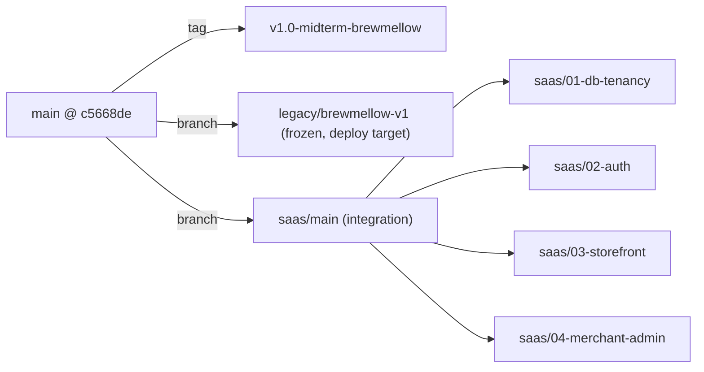
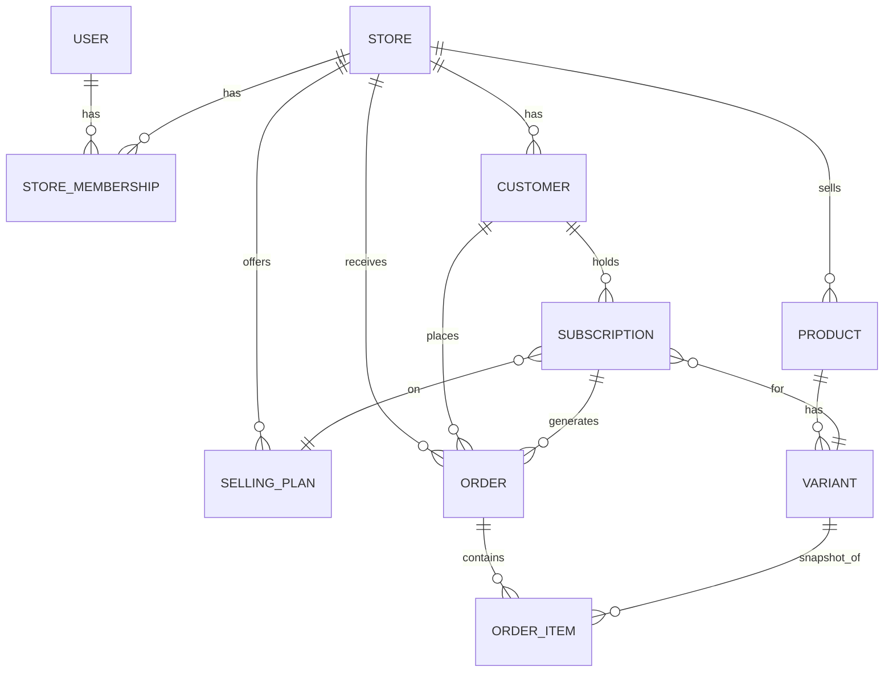
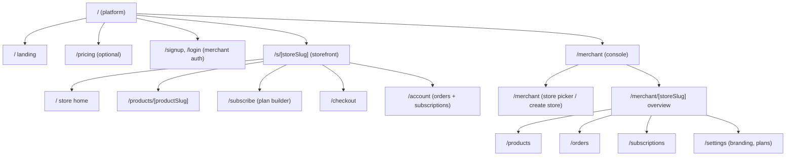

# BrewMellow to Multi-Tenant SaaS: Architecture Blueprint v0.1 (Planning Only)

> [!IMPORTANT]
> This is based on the code in `team_2_capstone_design` @ `c5668de` (main). Nothing gets implemented until the open questions at the end are answered.

---

## 0. What the code actually does today (this changes the plan)

| # | Finding | Evidence | Why it matters for SaaS |
|---|---|---|---|
| F1 | **There are two backends.** The browser never calls Django. Every `fetch` goes to Next.js route handlers (`/api/orders`, `/api/auth/*`), and they run **raw SQL against the tables Django created** (`orders_order`, `auth_user`) using `@neondatabase/serverless`. | [route.ts](file:///d:/Team2_Capstone_project/team_2_capstone_design/frontend/src/app/api/orders/route.ts), [db.ts](file:///d:/Team2_Capstone_project/team_2_capstone_design/frontend/src/lib/db.ts) | If we add a required `store_id` column with a Django migration, the live Next.js `INSERT` breaks right away. Tenant scoping has to be enforced in **one** place, not two. |
| F2 | **Auth isn't real.** `login/route.ts` never checks the password. Any email works, and any email containing `"admin"` gets `is_staff: true`. The session is `localStorage["demo_user"]`. | [login/route.ts](file:///d:/Team2_Capstone_project/team_2_capstone_design/frontend/src/app/api/auth/login/route.ts) | A "scoped merchant admin" is impossible without real auth. This is the **largest piece of scope nobody has counted yet**. |
| F3 | **The catalog lives in code.** Prices are a `SERVER_PRICES[origin_id][weight]` dict, and plan discounts are a TS constant. The `CoffeeOrigin` / `SubscriptionPlan` Django models exist, but the request path doesn't use them. `Order.origin_id` is a plain int, not a FK. | `orders/route.ts` L325-336, [subscriptions/models.py](file:///d:/Team2_Capstone_project/team_2_capstone_design/backend/subscriptions/models.py) | You can't hardcode a catalog per merchant, so the catalog has to move into the DB. |
| F4 | **There's no Order/Subscription split.** A "subscription" is just an `Order` row with `plan_id='3M'`. Week 8 docs **cut** the recurrence engine on purpose. | [orders/models.py](file:///d:/Team2_Capstone_project/team_2_capstone_design/backend/orders/models.py), `post-midterm-reset...md` §4 | "Orders + subscriptions" needs a decision about how deep to go (see Q3). |
| F5 | **Failures are hidden.** The API routes return fake seeded data or random IDs when the DB fails. | `FALLBACK_ORDERS` | In multi-tenant code, a silent fallback can show Tenant A's fixtures to Tenant B. All fallbacks must go. |
| F6 | **One `DATABASE_URL` is shared.** Local dev and Vercel likely point at the same Neon DB. | `.env.local` files | Running a migration locally could break the deployed midterm demo. |
| F7 | **A schedule conflict to check:** Week 8 docs set Khalti sandbox as P0 and the Week 11 freeze for Nov 12. | `post-midterm-reset...md` | Doing the SaaS pivot and Khalti in 4 weeks solo isn't realistic. One of them has to give. |

---

## 1. Safe isolation: freeze the baseline

### 1.1 Git

1. **Before tagging:** decide on the untracked `audit/` and `apple-touch-icon.png`. Commit them or gitignore them so the tag is a clean snapshot.
2. Create the annotated tag `v1.0-midterm-brewmellow` and push it. The tag can't move, so it's the thing to roll back to.
3. Create a `legacy/brewmellow-v1` branch with GitHub branch protection (no pushes, no force). Hotfixes only, cherry-picked.
4. All new work goes in short-lived feature branches merged into `saas/main`. `main` gets fast-forwarded to `saas/main` only at **cutover** (end of week 3), once the parity checklist passes.

### 1.2 Deployments
- **Vercel Production** stays on `legacy/brewmellow-v1` (or `main`, frozen) until cutover.
- **Vercel Preview** builds `saas/*` branches with their **own** env vars.
- Django host: the same split if it's deployed (see Q1).

### 1.3 Database (the riskiest part)
- Use a **Neon branch** `saas-dev` copied from production. It's a copy-on-write clone, so it's free and instant, and prod data stays untouched. Preview and local use the `saas-dev` connection string. Prod Neon is **read-only from our side** until cutover.
- Take a **Neon snapshot** of prod right before cutover. That's the DB rollback.
- Write migrations as **expand → backfill → contract**:
  1. *Expand:* add `store_id` as **nullable** and add the new tables. Old code keeps working.
  2. *Backfill:* a data migration sets every existing row to `store = brewmellow`.
  3. *Contract:* make it `NOT NULL` and drop the legacy columns, **only after** nothing reads them.

### 1.4 Characterization tests (do these before changing anything)
- Turn the README "Repeatable Smoke Test" into a script (Playwright, or a curl script plus a checklist): browse origins → checkout → order row exists → customer dashboard lists it → admin can change the status.
- Run it against the legacy deploy now to record what "working" looks like. Run it against `/s/brewmellow/...` after every merge. **BrewMellow parity is the acceptance gate for cutover.**

---

## 2. Core domain abstraction

### 2.1 Tenancy strategy: shared schema, `store_id` on every row
| Option | Verdict |
|---|---|
| Schema per tenant (`django-tenants`) | ❌ Wants subdomain routing, Postgres schemas, and per-schema migrations. It fights Neon serverless and the raw SQL in Next.js. 2+ weeks of infrastructure on its own. |
| DB per tenant | ❌ Out of the question. |
| **Shared schema plus a `store` FK, enforced in one service layer** | ✅ Simple, works with Neon, and easy to demo and test. This is how most SaaS starts out. |

### 2.2 Target entity model

| Entity | Key fields (conceptual) | Replaces |
|---|---|---|
| **Store** (the tenant) | `slug` (unique, URL-safe), `name`, `tagline`, `currency` (default NPR), `theme` JSON (colors, logo URL, hero image), `is_active` | Hardcoded "BrewMellow" strings in `layout.tsx`, `Footer.tsx`, `Navbar.tsx` |
| **StoreMembership** | `user`, `store`, `role` (OWNER / STAFF) | `is_staff` hack. *A minimal version could be `Store.owner` FK only (see Q2).* |
| **Product** | `store`, `slug`, `name`, `description`, `image_url`, `attributes` JSON, `is_active`, `allow_one_time`, `allow_subscription` | `CoffeeOrigin`. Altitude, process, and tasting notes go in `attributes`, so non-coffee merchants work too |
| **Variant** | `product`, `label` ("250 g"), `price_minor` (int), `sku`, `is_active` | `SERVER_PRICES[origin][weight]`, `weight_kg` float |
| **SellingPlan** | `store`, `name`, `interval` (every N weeks/months), `commitment_cycles` (1/3/6/12), `discount_pct` | `SubscriptionPlan` choices + `PLAN_DISCOUNTS` TS constant |
| **Customer** | `store`, `user` (nullable, so guests work), `email`, `name`, `phone`, `default_address`. Unique on (`store`, `email`) | `CustomerProfile` (global today, per-store after) |
| **Order** | `store`, `customer`, `type` (ONE_TIME / SUBSCRIPTION_CYCLE), `subscription` (nullable), `status` (state machine), `subtotal_minor`, `discount_minor`, `total_minor`, `currency`, shipping snapshot, `payment_provider`, `payment_ref`, `is_test` | `Order` (flat) |
| **OrderItem** | `order`, `variant` (FK, nullable on delete), `product_name` / `variant_label` / `unit_price_minor` **snapshots**, `qty` | `origin_name`, `plan_name` columns |
| **Subscription** | `store`, `customer`, `variant`, `selling_plan`, `status` (ACTIVE / PAUSED / CANCELLED), `next_delivery_date`, `cycles_remaining` | Implied by `plan_id` today. Feeds the dashboard pause/skip UI |

**Rules that apply to everything:**
- **Money is an integer in minor units.** No floats and no client-sent totals. The server reprices from `Variant` + `SellingPlan`. (Today it accepts the client price when it's ≥80% of the real one. That's a bug.)
- **Order lines are snapshots.** If a merchant later edits a price, past orders don't change.
- **Tenant scoping has one choke point:** a `StoreScopedQuerySet` / `for_store(store)` manager plus a DRF permission that resolves `store` **from the URL slug**. `store_id` is **never** read from the request body. Every view goes through it.
- **Slugs** are unique, lowercase, and checked against a reserved list (`admin`, `api`, `merchant`, `s`, `login`…).

### 2.3 Legacy data migration for BrewMellow as Tenant #1
1. Seed `Store(slug="brewmellow")` along with its theme taken from the current hardcoded colors (`#A3432A`, etc.).
2. Seed 3 Products (Gulmi, Ilam, Nuwakot) × 4 Variants from `SERVER_PRICES`, plus 5 SellingPlans from `PLAN_DISCOUNTS`.
3. For each legacy `orders_order` row: get-or-create a `Customer` by email, create an `Order` plus one `OrderItem` that maps `origin_id → product` and `weight_kg → variant`, and convert `NPR int → minor`.
4. Keep legacy columns (or the whole legacy table renamed `legacy_order`) until cutover, then drop them in the contract step.

### 2.4 Backend consolidation (prerequisite, see Q1)
Before any of this, **pick one backend of record**. My recommendation is **Django + DRF owns every read and write**, and the Next.js `/api/*` handlers are deleted (or kept as a thin same-origin proxy so cookies stay simple). Keeping raw SQL in Next.js means writing tenant scoping twice and keeping it in sync with Django migrations by hand. With one developer and 4 weeks, that's the most likely source of a cross-tenant data leak.

---

## 3. Routing and UI blueprint

### 3.1 Route map (Next.js App Router)

| Area | Layout responsibility | Notes |
|---|---|---|
| `app/(platform)/` | SaaS brand navbar/footer | New, minimal. One marketing page is enough for the capstone. |
| `app/s/[storeSlug]/layout.tsx` | **Server component** fetches `Store` by slug → `notFound()` if missing or inactive. Injects theme as CSS variables. Provides a `StoreContext`. | Existing BrewMellow pages move in here and read their branding from context instead of hardcoded strings. |
| `app/merchant/[storeSlug]/layout.tsx` | Auth guard plus a **membership check** on the server (middleware handles the redirect, Django handles the real authorization) | Reuses and generalizes the current `/admin` page. Named `/merchant` so it doesn't collide with Django's `/admin/` or the customer `/account`. |

### 3.2 Legacy URL preservation
In `next.config.ts`, add `redirects()` mapping `/origins`, `/subscribe`, `/checkout`, `/dashboard`, `/admin` → `/s/brewmellow/...` / `/merchant/brewmellow`, with `permanent: false` during the transition so the midterm demo links and QR codes keep working.

### 3.3 Client-state hygiene
- Namespace **every** `localStorage` key by store (`bm:{storeSlug}:cart`, …). Today `cached_admin_orders` and `demo_user` are global and would leak across tenants on the same browser.
- Remove `cached_admin_orders`. Merchant data should never sit in localStorage.
- PWA: the service worker can cache `/api/*` responses across tenants. Exclude the API from caching or turn PWA off on `/merchant`. Keep the manifest **platform-level**. A per-tenant PWA manifest is out of scope.

### 3.4 Component generalization (just enough)
- `OriginCard` → `ProductCard` that renders `attributes` generically (key/value chips). BrewMellow-flavored extras like `TasteMatcher` stay as optional "store features" and only show when `store.slug === 'brewmellow'` or a feature flag in `theme`. **Don't build a theme engine.**

---

## 4. Scope guardrails (4 weeks, 1 developer)

### Explicitly out of scope
- Subdomains or custom domains per store (`brewmellow.ourapp.com`)
- Per-merchant payouts / Stripe Connect / Khalti merchant onboarding
- Real automated recurring charging (cron rebilling)
- Drag-and-drop theme editor, per-tenant PWA, inventory, multi-currency, roles beyond OWNER

### Draft 4-week plan
| Week | Goal | Exit criterion |
|---|---|---|
| **W1** | Freeze + Neon branch + backend-of-record decision + new models + expand/backfill migrations + seed BrewMellow | Legacy demo untouched. `saas-dev` DB has BrewMellow as Store #1 with all old orders migrated |
| **W2** | Real auth (merchant + customer) + store-scoped DRF APIs + `/s/[storeSlug]` storefront at BrewMellow parity | Smoke test passes on `/s/brewmellow` |
| **W3** | Merchant console (products CRUD, orders status, settings/branding) + "create store" onboarding + seed a **2nd demo tenant** that looks visibly different | Two stores, and an automated **cross-tenant isolation test** (merchant A gets 404 on store B's resources) |
| **W4** | Subscription lifecycle (pause/skip/cancel, "generate next cycle order" action) + redirects + cutover + docs/demo script. **Feature freeze mid-week.** | Production cut over, rollback rehearsed |

---

## 5. Open questions (blocking)
See the chat message. Answers here will update §2.2, §2.4, and §4.
