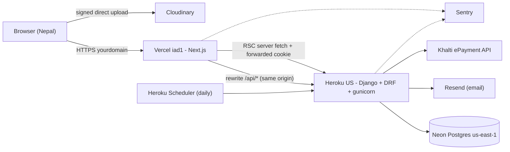
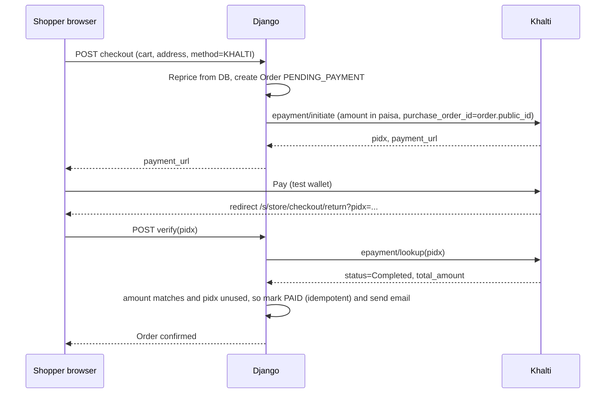

# Build Decision Record v1: What we build, how, and why

> [!NOTE]
> This replaces §1.3 (database isolation) and §2.4 (backend choice) of [saas_blueprint.md](file:///C:/Users/adity/.gemini/antigravity/brain/7c916917-731f-496e-80ef-61467e649205/saas_blueprint.md). The data model and routing from that doc still apply. Window: **Oct 30 → Nov 26** (4 weeks).

---

## 1. What we are building (one sentence)

**A free-for-merchants SaaS where any Nepali merchant signs up, launches a branded storefront at `/s/{store}`, sells products as one-time purchases or non-recurring subscriptions, and gets paid via Khalti (sandbox) or Cash on Delivery. BrewMellow is the flagship demo store.**

### Personas
| Persona | Where | What they can do |
|---|---|---|
| **Merchant** | `/merchant/...` | Sign up, create one or more stores, manage branding, products, variants, plans, orders, subscriptions, customers |
| **Shopper** | `/s/{store}/...` | Create an account, browse, add to cart, check out (Khalti/COD), manage orders, addresses, subscriptions |
| **Platform admin (us)** | Django `/admin/` | Suspend stores, look at any data, support. Comes free with Django. |

### MVP feature list (the contract)
| Area | Must ship |
|---|---|
| Platform | Landing page, merchant sign-up/login, email verification, password reset |
| Onboarding | "Create your store" wizard: name, slug, logo, brand color, contact, optional Khalti key |
| Catalog | Products with images, variants (size/weight) with prices, active/draft, per-product "allow subscription" plus selling plans |
| Storefront | Themed home, product page, **multi-item cart for one-time items**, checkout behind login, Nepali address form |
| Payments | **Khalti ePayment v2 sandbox** (initiate → redirect → server-side lookup verify) **+ Cash on Delivery** |
| Orders | State machine, merchant status updates, shopper order history, confirmation email |
| Subscriptions | Prepaid commitment (3/6/12 cycles, paid upfront) **and** pay-per-delivery (a renewal order plus a "Pay now" link each cycle). Pause, skip, cancel. |
| Merchant console | Overview stats (orders, revenue), orders, subscriptions, customers, products, settings |
| Trust | Store isolation enforced and **covered by automated tests**, rate-limited login, server-side pricing |

### Explicitly NOT building (in these 4 weeks)
Custom domains or subdomains, automatic recurring charges, platform fees or merchant billing, eSewa/Fonepay, inventory/stock tracking, discount codes, reviews, theme editor, multi-staff roles, mobile app, multi-currency, live courier tracking.

> [!WARNING]
> **Why Cash on Delivery is in:** most online orders in Nepal are COD. It's about half a day of work (no gateway) and it makes the product believable to a real market. Khalti stays as the online method.

---

## 2. Stack and deployment

### 2.1 Choices
| Layer | Choice | Why | Student Pack / cost |
|---|---|---|---|
| Frontend | **Next.js 16 on Vercel** (already in use) | Already working. Server components and ISR suit storefront pages. Preview deploy per branch. | Hobby = free ⚠️ *non-commercial only* |
| Backend | **Django 5 + DRF on Heroku** (Basic dyno, US region) | Always on (no cold starts at the demo). `git push` deploys. Free Scheduler add-on handles the daily subscription job. Django gives us auth, password reset, ORM, migrations, and the admin. | **Pack: $13/mo credit for 24 months.** Basic dyno $7/mo, so $0 out of pocket |
| Database | **Neon Postgres, `us-east-1`** (already in use) | Branching gives a free, instant DB copy per environment. Same region as Heroku US and Vercel `iad1`. | Free tier (0.5 GB) is plenty for a capstone |
| Images | **Cloudinary** | Signed direct uploads from the browser, automatic resizing and WebP, CDN. Merchants upload logos and product photos. | Free tier |
| Email | **Resend** via `django-anymail` | Verification, password reset, order confirmation, renewal "Pay now". `anymail` lets us switch providers later with no code changes. | Free tier (~3k/mo). Needs a domain |
| Domain | **Free domain from the Pack** (Namecheap `.me` or name.com) | Needed for email sending, Khalti `website_url`, and to look professional | Free for year 1 |
| Errors | **Sentry** (Django + Next.js) | Production error visibility when you're the only developer | Pack / free |
| CI | **GitHub Actions** | Django tests (incl. isolation tests), `next build`, lint on every PR. Heroku auto-deploys only after CI passes. | Free |
| Uptime | UptimeRobot / Better Stack on `/api/health/` | Know before the demo if something is down | Free |

> [!IMPORTANT]
> **Things to fix in what we have:**
> - DigitalOcean **left the Student Pack**, so the README's "Deployed on DigitalOcean" isn't possible. That's why the plan uses Heroku.
> - Heroku's Pack offer requires age **18+** and a verified student account. Claim it **before day 1**.
> - Vercel Hobby forbids commercial use. When this becomes a real business, move to Vercel Pro (~$20/mo) or self-host Next.js.

### 2.2 Why these and not the alternatives
| Option | Rejected because |
|---|---|
| Azure App Service ($100 Pack credit) | Closer regions (India/SEA), but the credit runs out in ~7 months on B1 and setup takes longer. **Good later option if latency matters.** |
| Render free | Sleeps after inactivity. A 30–60 s cold start during the demo kills the demo. |
| Django on Vercel serverless | Cold starts, no scheduler, Postgres connection churn. Django isn't built for it. |
| Next.js-only (delete Django) | We'd lose admin, auth, migrations, and a permission framework, and rebuild them by hand in 4 weeks. |
| Keep both backends writing the DB | Store scoping written twice, so a cross-store data leak is likely. **The Next.js `/api/*` SQL routes get deleted.** |

### 2.3 Deployed architecture


**Region:** everything runs in US-East so app ↔ DB calls stay within ~1 ms. Users in Nepal pay one ~250 ms round trip per page. ISR caching of storefront and product pages hides most of it. If we go live for real, we move the whole stack to Singapore or Mumbai together, never one piece at a time.

### 2.4 Environments
| Env | Frontend | Backend | DB |
|---|---|---|---|
| Legacy (frozen midterm) | current Vercel prod | none (Next API routes) | current Neon `main` branch, **never touched again** |
| Dev (local) | `npm run dev` | `runserver` | Neon branch `dev` |
| Staging | Vercel Preview (`saas/main`) | Heroku app `*-staging` | Neon branch `staging` |
| Production | Vercel Prod (after cutover) | Heroku app `*-prod` | **New** Neon branch/DB `prod-saas` |

> [!TIP]
> **Simpler than my first plan:** the SaaS gets a **fresh database with fresh migrations**, and BrewMellow is loaded by an idempotent `seed_brewmellow` command (store, 3 products × 4 variants, plans, plus importing the handful of legacy orders). The legacy app keeps its own DB untouched forever, so we don't need expand/contract migrations on a live DB. Your midterm baseline can't break.

---

## 3. How: key designs

### 3.1 Identity and auth
- **Custom user model now** (`accounts.User`, email as the login, no username). Today is the last cheap moment to switch, since we're starting a fresh DB anyway.
- **One global account, per-store customer records.** A person has one login. The first time they sign up or buy at a store, a `Customer(store, user)` row is created. **A merchant only ever sees their own `Customer` rows.** The same person can be both a merchant and a shopper.
- **Django session cookies, served same-origin** through a Next.js `rewrites()` proxy (`/api/* → Heroku`):
  - The cookies are first-party and `HttpOnly`, so there's no JWT refresh logic and no tokens in `localStorage`.
  - Django's CSRF protection works as designed.
  - Server components forward the incoming `cookie` header when they call Django.
- Built-in Django password reset and email verification tokens. DRF throttling on login, register, and reset.
- `localStorage["demo_user"]` and every mock user are **deleted**.

### 3.2 Store isolation (the most important correctness property)
1. Every store-owned model has `store = FK(Store)` and a `StoreScopedManager`.
2. API URLs carry the store: `/api/stores/{slug}/...` (public storefront) and `/api/merchant/stores/{slug}/...` (console).
3. One DRF mixin resolves `store` from the slug, checks `StoreMembership` for merchant routes, and **all querysets go through `.for_store(store)`**. The `store` field is never writable from the request body.
4. An automated test matrix: merchant A calls each merchant endpoint of store B and gets **404**. Shopper X asks for shopper Y's order and gets **404**. CI fails if any of these leak.

### 3.3 Payments (Khalti sandbox + COD)

- **Each store has its own Khalti config** (`mode=test/live`, secret key **encrypted at rest**). If a store hasn't set one, it falls back to the **platform sandbox key** and shows a "Test mode" badge.
- **Why per-store keys:** in production, money goes **directly to each merchant's own Khalti account**. The platform never holds anyone's funds. That keeps us away from NRB payment-aggregator licensing, the main legal risk of "Shopify for Nepal".
- The query params on the return URL are **never trusted**. Only the server-side `lookup` decides. `pidx` is unique per payment, so a double-submit can't double-pay.
- COD: the order goes straight to `CONFIRMED` with `payment_status=COD_PENDING`, and the merchant marks it collected on delivery.

### 3.4 Subscriptions without recurring billing
| Type | What the shopper pays | What the system does |
|---|---|---|
| **Prepaid commitment** (3/6/12 cycles, discounted) | One Khalti payment upfront | Creates a `Subscription` with `cycles_total`. Each cycle the daily job creates a **zero-charge fulfillment order** for the merchant to ship. |
| **Pay per delivery** | One payment per cycle | N days before each cycle, the job creates a `PENDING_PAYMENT` renewal order and emails a **"Pay now"** link (also shown in the account). If it's unpaid by the cutoff, that cycle is **skipped**, never charged automatically. |

- The daily job is `manage.py run_subscription_cycles` on Heroku Scheduler, built to be **idempotent** (unique on `subscription + cycle_number`), so re-runs are harmless. A merchant-side "Run now" button lets us demo it live.
- Shoppers can **pause, skip next, or cancel**. COD is allowed for pay-per-delivery renewals.
- Subscription checkout is **one item per checkout**. The cart is for one-time items only. Shopify does the same, and it keeps payments simple.

### 3.5 Order state machine
`PENDING_PAYMENT → PAID/CONFIRMED → PROCESSING → SHIPPED → DELIVERED`, with `CANCELLED` and `PAYMENT_FAILED` as exits. Transitions are only allowed in one service function. Each change is logged in an `OrderEvent` row, which gives a timeline in both consoles.

### 3.6 Shopper data captured (to "know who is buying")
Verified email, full name, Nepali mobile (validated `98/97xxxxxxxx`), address with **Province → District → Municipality → Ward → Street/Landmark**, and an optional delivery note. Addresses are saved per user. Each order stores a **snapshot** of the address used.

---

## 4. Repository restructure (on `saas/main`)
```
backend/
  config/            settings split: base / dev / prod (env-driven)
  accounts/          custom User, auth endpoints, addresses
  stores/            Store, StoreMembership, PaymentConfig, isolation mixins
  catalog/           Product, Variant, SellingPlan, images
  orders/            Cart, Order, OrderItem, OrderEvent, checkout service
  payments/          Khalti client, COD, verification
  subscriptions/     Subscription, cycle generator command
  notifications/     email templates via anymail
  requirements.txt, Procfile, runtime file, .python-version
frontend/src/app/
  (platform)/        /, /login, /signup, /verify, /reset
  s/[storeSlug]/     storefront (layout loads store + theme)
  merchant/          store picker, onboarding, /merchant/[storeSlug]/...
  lib/api/           typed fetch client (server + client variants)
```
The legacy Django apps and Next.js `/api` routes are removed on this branch. They stay intact in tag `v1.0-midterm-brewmellow`.

---

## 5. Four-week plan (each week ends with something deployed)

| Week | Dates | Build | Exit criterion (demoable on staging) |
|---|---|---|---|
| **W1: Foundation** | Oct 30 – Nov 5 | Freeze/tag legacy. Claim Pack offers + domain. Heroku staging + Neon branches + Vercel rewrites + CI + Sentry. New Django apps and models. Custom user, session auth, verify/reset email. `seed_brewmellow`. Isolation mixins and the first isolation tests. | Sign up, verify email, and log in work end-to-end on staging. BrewMellow data is in the new DB. |
| **W2: Merchant side** | Nov 6 – 12 | Create-store wizard, merchant console shell, products/variants/images (Cloudinary), selling plans, store settings/branding, Khalti key settings | A brand-new merchant creates a store and publishes products from the UI |
| **W3: Shopper side** | Nov 13 – 19 | `/s/[slug]` themed storefront (BrewMellow pages ported), product page, cart, checkout with address, **Khalti sandbox + COD**, confirmation email, shopper order history, merchant order management | A real sandbox Khalti purchase on **two visually different stores**. Isolation test suite green. |
| **W4: Subscriptions + launch** | Nov 20 – 26 | Prepaid + pay-per-delivery, the daily job, pause/skip/cancel, landing page, legacy redirects, production cutover, demo script, docs. **Feature freeze Nov 24**, then bug fixes only. | Production live. Full demo script rehearsed twice. Rollback plan written. |

> [!CAUTION]
> **What fails first if we slip:** cut in this order: (1) pay-per-delivery renewals (keep prepaid only), (2) merchant overview stats, (3) multiple stores per merchant (limit to 1). **Never cut** isolation tests, server-side payment verification, or the W1 deploy pipeline.

---

## 6. Risks I'm watching
| Risk | Likelihood | Mitigation |
|---|---|---|
| Building UI for two apps (storefront + console) solo | High | Reuse existing BrewMellow components for the storefront. A plain, table-heavy console (no fancy charts). |
| Khalti sandbox downtime or account approval delays | Medium | Register the sandbox merchant **in W1**. COD keeps checkout demoable regardless. |
| Cross-site cookie / CSRF problems | Medium | Same-origin rewrites are set up and verified in W1 before any feature work. |
| Neon free-tier autosuspend makes the first request slow | Low | Uptime ping every 5 min during demo week. |
| Nov 12 "freeze gate" in the Week 8 docs | Unknown | **Confirm the real deadline** (question below). |
