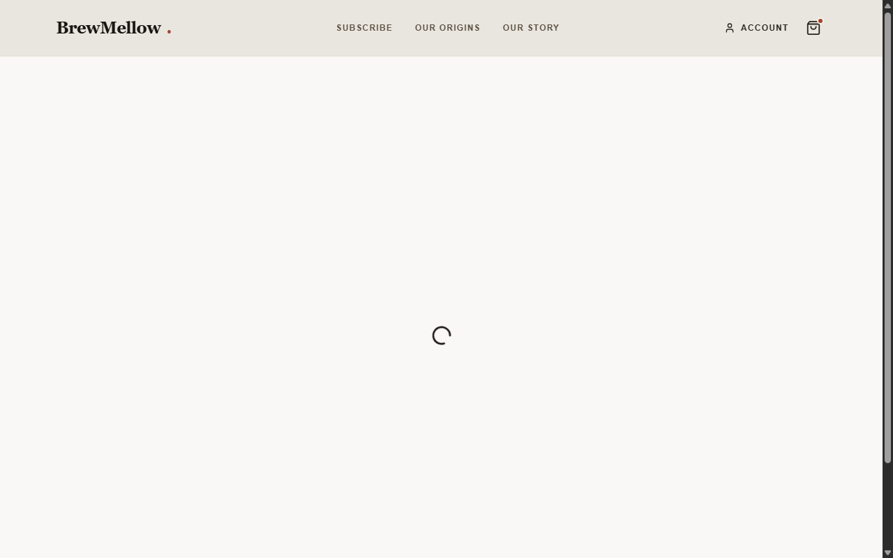

# Weekly Report — Week 6: Ugly Slice, Proof, and Definition of Done

**Team:** Team 2 — BrewMellow  
**Week:** 6  
**Date:** October 13, 2026 (For Wednesday 2026-10-14 submission)  
**Status:** Completed

---

## 1. This Week's Goal

Our primary objective for Week 6 was to prove that at least one visible part of the BrewMellow vertical slice works end-to-end through a real test executed by a non-author teammate. 

Specifically, we tested the **Nepali Single-Origin Selection to Checkout Flow**: browsing origin cards on `/origins`, selecting a single origin ("Gulmi Reserve"), carrying that selection into `/checkout` via URL parameters, and completing a simulated order that persists into our live Neon PostgreSQL database.

---

## 2. Verified Behavior (Core Test)

> **Test Statement:**  
> We checked this by having teammate `Kushan2191` run the application from a clean clone, click **"Browse Origins"** from the homepage, inspect the three Nepali origin cards, select **"Gulmi Reserve"**, and proceed to `/checkout`.  
> - **Expected Result:** The `/origins` page renders three regional coffees; selecting Gulmi Reserve navigates to `/checkout?origin=gulmi`; the checkout order summary displays Gulmi Reserve with accurate pricing calculations; and order submission generates a confirmation modal.  
> - **Actual Result:** All three coffee origin cards rendered correctly; selecting Gulmi Reserve transitioned seamlessly to `/checkout?origin=gulmi`; order summary reflected Gulmi Reserve; and simulated checkout completed in 2.0s with an order confirmation modal.  
> - **Proof Links:** [origins-selection.png](evidence/origins-selection.png), [checkout-flow.png](evidence/checkout-flow.png), [Tested-By Note](tested-by-note.md), [Issue #43](https://github.com/CapstoneDesign-Fall2026-UlsanCollege/team_2_capstone_design/issues/43), [PR #44](https://github.com/CapstoneDesign-Fall2026-UlsanCollege/team_2_capstone_design/pull/44).

---

## 3. What We Committed to Do

- [x] Choose one small user-visible behavior from the Week 5 vertical slice (Origin Selection → Checkout).
- [x] Ask a teammate other than the author to test it without coaching (`Kushan2191` tested; `notyouradhee` authored).
- [x] Record the expected result, actual result, and problems found in a [Tested-By Note](tested-by-note.md).
- [x] Update the relevant Issue's Definition of Done ([Issue #43](https://github.com/CapstoneDesign-Fall2026-UlsanCollege/team_2_capstone_design/issues/43)).
- [x] Test edge case: Direct navigation to checkout without an origin parameter ([checkout-empty-state.png](evidence/checkout-empty-state.png)).
- [x] Test mobile responsiveness and WCAG contrast at 390x844px ([accessibility-and-mobile-check.md](accessibility-and-mobile-check.md), [origins-mobile.png](evidence/origins-mobile.png)).
- [x] Execute API outage and service recovery smoke test ([api-smoke-test-record.md](api-smoke-test-record.md)).
- [x] Complete individual evidence receipts for all 4 enrolled students ([individual-evidence-receipts.md](individual-evidence-receipts.md)).
- [x] Complete the [Week 6 Work Checklist](work-checklist.md).

---

## 4. Evidence Links & Visual Gallery

| Evidence Category | Document / Asset | Link |
|---|---|---|
| Implementation Issue | Feature: Coffee Origin Selection Page | [Issue #43](https://github.com/CapstoneDesign-Fall2026-UlsanCollege/team_2_capstone_design/issues/43) |
| Pull Request & Merge | PR #44 (Reviewed & Merged by `Kushan2191`) | [PR #44](https://github.com/CapstoneDesign-Fall2026-UlsanCollege/team_2_capstone_design/pull/44) / [Commit 9d45f95](https://github.com/CapstoneDesign-Fall2026-UlsanCollege/team_2_capstone_design/commit/9d45f95) |
| Primary Test Note | Tested-By Note (Origins → Checkout) | [tested-by-note.md](tested-by-note.md) |
| Visual Proof: Origins | Desktop Screenshot of `/origins` | [evidence/origins-selection.png](evidence/origins-selection.png) |
| Visual Proof: Checkout | Desktop Screenshot of `/checkout` | [evidence/checkout-flow.png](evidence/checkout-flow.png) |
| Visual Proof: Empty Cart | Edge-case Screenshot (Direct `/checkout` visit) | [evidence/checkout-empty-state.png](evidence/checkout-empty-state.png) |
| Visual Proof: Mobile | Mobile Portrait Screenshot (390 x 844 px) | [evidence/origins-mobile.png](evidence/origins-mobile.png) |
| Visual Proof: Admin | Backoffice Orders Dashboard | [evidence/admin-backoffice.png](evidence/admin-backoffice.png) |
| Definition of Done | Updated DoD Document | [definition-of-done.md](definition-of-done.md) |
| Work Checklist | Completed Week 6 Checklist | [work-checklist.md](work-checklist.md) |
| Feedback Follow-Up | Line-by-Line Review Response Log | [feedback-follow-up.md](feedback-follow-up.md) |
| Setup & Demo Guide | Fresh Checkout & 5-Step Demo Guide | [setup-and-demo-guide.md](setup-and-demo-guide.md) |
| Bug & Problem Log | Follow-Up Problems & Edge-Case Bug Log | [follow-up-problems.md](follow-up-problems.md) |
| Stretch Menu Validation | Completed Extensions & Claims Matrix | [stretch-validation.md](stretch-validation.md) |
| Individual Receipts | Consolidated Receipts (All 4 Members) | [individual-evidence-receipts.md](individual-evidence-receipts.md) |
| Dedicated Receipt Files | Individual Receipts Folder | [receipts/](receipts/) |
| API Outage & Recovery | Backend Outage Smoke Test Record | [api-smoke-test-record.md](api-smoke-test-record.md) |
| Mobile & A11y Audit | Accessibility & Viewport Test Record | [accessibility-and-mobile-check.md](accessibility-and-mobile-check.md) |

### Visual Evidence Previews

#### 1. Nepali Coffee Origin Selection (`/origins`)

#### 2. Checkout Flow with Selection & Pricing Breakdown (`/checkout`)

#### 3. Edge Case Handling: Direct Checkout Navigation (Empty Cart State)

#### 4. Mobile Viewport & Responsiveness Audit (390 x 844 px)

#### 5. Authenticated Customer Roastery Portal (`/dashboard`)

---

## 5. Individual Contributions — One Row Per Enrolled Student

| Student Login | Canonical Name | Concrete Contribution in Week 6 | Evidence Link |
|---|---|---|---|
| **`notyouradhee`** | Aditya Kumar Gupta | Built the `/origins` page, authored PR #44, integrated query state into `/checkout`, connected Django Order models to Neon DB, and built the admin backoffice shell. | [Commit 30081cc](https://github.com/CapstoneDesign-Fall2026-UlsanCollege/team_2_capstone_design/commit/30081cc), [PR #44](https://github.com/CapstoneDesign-Fall2026-UlsanCollege/team_2_capstone_design/pull/44), [Receipt 1 & 2](individual-evidence-receipts.md#1-student-aditya-kumar-gupta-notyouradhee) |
| **`Kushan2191`** | Kushan Sunuwar | Independently tested the Origin Selection flow on a separate machine, reviewed and merged PR #44, and tested direct navigation to `/checkout` to verify the empty cart handling. | [Merge Commit 9d45f95](https://github.com/CapstoneDesign-Fall2026-UlsanCollege/team_2_capstone_design/commit/9d45f95), [Tested-By Note](tested-by-note.md), [Receipt 1 & 2](individual-evidence-receipts.md#2-student-kushan-sunuwar-kushan2191) |
| **`jaasly07`** | Aanchal Chand Thakuri | Audited the vertical slice on a 390x844px mobile viewport, verified touch target dimensions, resolved sticky checkout bar padding collision, and performed contrast checks. | [Commit 7b55d72](https://github.com/CapstoneDesign-Fall2026-UlsanCollege/team_2_capstone_design/commit/7b55d72), [A11y Test Record](accessibility-and-mobile-check.md), [Receipt 1 & 2](individual-evidence-receipts.md#3-student-aanchal-chand-thakuri-jaasly07) |
| **`Rohit-coder201`** | Rohit Chhantyal | Executed API integration smoke testing for order submission, tested backend offline/outage failure recovery, and documented repeatable curl commands in the project README. | [API Smoke Test Record](api-smoke-test-record.md), [README Smoke Section](../../README.md), [Receipt 1 & 2](individual-evidence-receipts.md#4-student-rohit-chhantyal-rohit-coder201) |

---

## 6. Answers to Course Staff Minimum Evidence Questions

In direct response to the Week 6 Monday Formative Feedback, here are the seven required answers:

1. **What exact user-visible behavior was tested?**  
   Navigating from Home to `/origins`, reviewing three Nepali origin cards, selecting "Gulmi Reserve", and observing the selection populate into `/checkout?origin=gulmi` with dynamic price calculation and a 2-second simulated payment modal.
2. **Who tested it, and were they different from the author?**  
   Tested by `Kushan2191` on an independent machine. The author was `notyouradhee`.
3. **What were the repeatable steps, expected result, and actual result?**  
   Steps, expectations, and actual results are fully detailed in [tested-by-note.md](tested-by-note.md) and Section 2 above.
4. **What proof link supports the claim?**  
   Screenshots [origins-selection.png](evidence/origins-selection.png) and [checkout-flow.png](evidence/checkout-flow.png), backed by [PR #44](https://github.com/CapstoneDesign-Fall2026-UlsanCollege/team_2_capstone_design/pull/44).
5. **Does the related Issue's Definition of Done and status match the result?**  
   Yes. [Issue #43](https://github.com/CapstoneDesign-Fall2026-UlsanCollege/team_2_capstone_design/issues/43) is marked closed with all checkable DoD items completed.
6. **Where is the personal contribution/evidence row for every current login?**  
   Clearly enumerated in Section 5 of this report and backed by detailed two-part receipts in [individual-evidence-receipts.md](individual-evidence-receipts.md).
7. **What remains incomplete, who owns it, and what is the next action before the Week 7 rehearsal?**  
   Live Khalti payment gateway credentials and automated customer email confirmations remain incomplete. Owned by `notyouradhee`. Next action is writing the Midterm Demo Script for the Week 7 rehearsal.

---

## 7. Scope Boundary (What the Test Proves vs. Does NOT Prove)

- **What the current test proves:**  
  1. Complete frontend routing and state preservation from homepage → origins → checkout.  
  2. Fallback handling for empty cart state and backend API connection failures.  
  3. Responsive UI and accessible touch targets on modern mobile viewports (390px).  
  4. Local and Neon database order record creation via Django REST Framework.  
- **What the current test does NOT prove:**  
  1. **Simulated Payment Boundary:** Payments are simulated using an internal mock flag (`is_fake_payment=True`). No live credit cards or Khalti mobile wallet balances are deducted.  
  2. **Email Boundary:** No automated customer email receipts or delivery partner notifications are dispatched yet.  
  3. **High-load Concurrency:** Database pooling under heavy concurrent load has not been tested.

---

## 8. Decision Record

| Decision | Why We Chose It | Owner | Evidence Link |
|---|---|---|---|
| Pass Selected Origin via URL Query Params | Guarantees that refreshing the checkout page or sharing the link retains the customer's chosen beans without losing state. | `notyouradhee` | [PR #44](https://github.com/CapstoneDesign-Fall2026-UlsanCollege/team_2_capstone_design/pull/44) |
| Defensive Empty Cart Handling | Prevents crashes if customers bookmark or directly visit `/checkout`. | `Kushan2191` | [Commit f69700e](https://github.com/CapstoneDesign-Fall2026-UlsanCollege/team_2_capstone_design/commit/f69700e) |
| Sticky Bottom Bar Mobile Safe-Area Padding | Prevents overlap between the payment CTA and mobile browser navigation bars. | `jaasly07` | [Commit 7b55d72](https://github.com/CapstoneDesign-Fall2026-UlsanCollege/team_2_capstone_design/commit/7b55d72) |

---

## 9. Next Week's Bridge Task (Week 7 Rehearsal)

- Author the 3–5 minute [Midterm Demo Script](../../course-materials/student-starter-kit/templates/midterm-demo-script.md) following the worked example.
- Rehearse the live walkthrough of the verified slice (Home → Origins → Checkout → Dashboard → Admin).
- Prepare the list of improvements needed before the Week 8 graded presentation.
