# Midterm Demo Script — BrewMellow

**Course:** Capstone Design — Fall 2026  
**Team:** Team 2 — BrewMellow  
**Target Duration:** 3:45 to 4:00 minutes (Strict 5:00 maximum)  
**PowerPoint File:** [`BrewMellow_Midterm_Presentation.pptx`](BrewMellow_Midterm_Presentation.pptx)  
**Markdown Slides:** [`presentation-slides.md`](presentation-slides.md)  
**Interactive Slides:** [`slides.html`](slides.html)  
**Live Deployed Application:** [https://team-2-capstone-design-one.vercel.app](https://team-2-capstone-design-one.vercel.app)  
**Repository:** [https://github.com/CapstoneDesign-Fall2026-UlsanCollege/team_2_capstone_design](https://github.com/CapstoneDesign-Fall2026-UlsanCollege/team_2_capstone_design)

---

## 1. Run of Show and Timed Presentation Script

```mermaid
gantt
    title Midterm Presentation Timed Run-of-Show (4:00 Total)
    dateFormat X
    axisFormat %s s
    section 1. Title & Problem
    Aanchal (Slide 1 Title & Slide 2 User/Problem) :0, 40
    section 2. Scope & Live Demo
    Aditya (Slide 3 Scope & Slide 4 Vertical Slice) :40, 120
    section 3. Individual Contributions
    Aanchal (Slide 5 A11y & Persona Evidence) :120, 145
    Aditya (Slide 6 Full-Stack & PR #44 Evidence) :145, 170
    Kushan (Slide 7 QA & Merge Commit Evidence) :170, 195
    Rohit (Slide 8 Resilience & README Evidence) :195, 220
    section 4. Next Steps
    Aditya (Slide 9 Roadmap & Closing Q&A) :220, 240
```

---

### Slide 1: Title & Overview (0:00 – 0:10)
**Speaker:** **Aanchal Chand Thakuri (`@jaasly07`)**  
**Visual on Screen:** Slide 1 — BrewMellow Title, Subtitle, Team Roster & Live Links

> *"Good afternoon, Professor and classmates. We are Team 2, presenting **BrewMellow**—Nepali specialty coffee, roasted to order and delivered fresh. Our team consists of Aditya, Kushan, Rohit, and myself, Aanchal."*

---

### Slide 2 (1/8): The User & The Specialty Coffee Problem (0:10 – 0:40)
**Speaker:** **Aanchal Chand Thakuri (`@jaasly07`)**  
**Visual on Screen:** Slide 2 — Target User Persona & The Retail Coffee Problem

> *"Our target users are specialty coffee enthusiasts and home-brewers in Nepal and the diaspora who seek single-origin Himalayan beans with distinct elevations and processing methods for manual brewing—like V60, Aeropress, and French Press.
>
> Today, they face two major problems:
> 1. **Zero transparency in retail:** Kathmandu supermarket coffee is stale, dark-roasted commercial blend with no harvest altitude, processing method, or roast date.
> 2. **Inaccessible micro-lots:** High-grade beans from Gulmi, Ilam, and Nuwakot are mostly exported. Locals have no direct digital platform for fresh roast-to-order subscriptions."*

---

### Slide 3 (2/8): Scope of this Demo & Full-Stack Architecture (0:40 – 1:10)
**Speaker:** **Aditya Kumar Gupta (`@notyouradhee`)**  
**Visual on Screen:** Slide 3 — Technical Architecture & Transparent Scope Boundary

> *"I am Aditya, project lead and full-stack developer.
>
> For our architecture, we built a modern full-stack application: Next.js 16 with React 19 and Tailwind CSS deployed live on Vercel over HTTPS, communicating with a Django 5.1 REST Framework backend backed by a hosted PostgreSQL database on Neon.
>
> For engineering honesty, we establish a transparent scope boundary:
> - **What is verified today:** Our complete end-to-end slice—from browsing regional origins to checkout state synchronization, database order persistence, customer dashboard tracking, and the roastery backoffice console.
> - **What is simulated:** Payment processing is explicitly flagged as `is_fake_payment=True`. We do not charge real credit cards or Khalti balances yet, though real order records are validated, tracked, and stored in our database."*

---

### Slide 4 (3/8): Live Walkthrough: The Verified Vertical Slice (1:10 – 2:00)
**Speaker:** **Aditya Kumar Gupta (`@notyouradhee`)**  
**Visual on Screen:** Slide 4 — Live Application ([https://team-2-capstone-design-one.vercel.app/origins](https://team-2-capstone-design-one.vercel.app/origins))

> *(Action: Open live production app in browser at `/origins`)*
>
> *"Here is our live production site on Vercel.
>
> 1. **/origins:** Customers discover three distinct micro-lots: Gulmi Reserve at 1,600m, Ilam Gold at 1,800m, and Nuwakot Heritage at 1,400m.
> 2. **/checkout:** When I click **'Shop Gulmi Reserve'**, notice the URL parameters seamlessly carry the origin ID, plan, and price into `/checkout`. The subscription summary recalculates dynamically to Rs. 1,200 with zero client state loss.
> 3. **POST /api/orders/:** Submitting our order form writes an order row to PostgreSQL and opens our 2.0-second simulated confirmation modal.
> 4. **/dashboard and /admin:** Customers monitor their order across a 4-stage delivery tracker—Confirmed, Roasting, Dispatched, Delivered—while the roastery backoffice displays Rs. 22,150 in revenue and active roasting queues."*

---

### Slide 5 (4/8): Individual Contribution: Aanchal Chand Thakuri (2:00 – 2:25)
**Speaker:** **Aanchal Chand Thakuri (`@jaasly07`)**  
**Role:** Frontend & Accessibility Auditor  
**Visual on Screen:** Slide 5 — Concrete Contributions (Left) & GitHub Commit `ca35b07` Evidence Screenshot (Right)

> *"For my individual contribution:
> - I formulated the specialty coffee target user persona and identified our retail transparency problem.
> - I audited our vertical slice at a 390px mobile viewport against WCAG 2.1 AA standards, ensuring single-column card stacking with zero horizontal overflow.
> - I ensured all CTA buttons provide a 52px touch-friendly thumb target (`py-3 px-6`) and fixed the sticky checkout button collision with mobile tab bars by introducing safe-area padding (`pb-28`).
>
> This is backed by commit `ca35b07`, our mobile test audit in `docs/week-06/`, and receipt receipt-aanchal.md."*

---

### Slide 6 (5/8): Individual Contribution: Aditya Kumar Gupta (2:25 – 2:50)
**Speaker:** **Aditya Kumar Gupta (`@notyouradhee`)**  
**Role:** Project Lead & Full-Stack Developer  
**Visual on Screen:** Slide 6 — Concrete Contributions (Left) & GitHub PR #44 / Issue #43 Screenshots (Right)

> *"For my individual contribution:
> - I architected the full-stack system linking Next.js 16, Django REST Framework, and Neon PostgreSQL.
> - I built the URL query parameter state-sync engine between `/origins` and `/checkout`, ensuring cart selections survive page reloads and bookmarks.
> - I deployed our production application to Vercel with automated continuous deployment and configured the backend API proxy.
> - I implemented the customer delivery dashboard, admin console, and the honest simulated payment boundary (`is_fake_payment=True`).
>
> This is verified by Issue #43, merged Pull Request #44, and commit `30081cc`."*

---

### Slide 7 (6/8): Individual Contribution: Kushan Sunuwar (2:50 – 3:15)
**Speaker:** **Kushan Sunuwar (`@Kushan2191`)**  
**Role:** QA Lead & Code Reviewer  
**Visual on Screen:** Slide 7 — Concrete Contributions (Left) & GitHub PR #44 Merge Commit `9d45f95` Screenshot (Right)

> *"I am Kushan, QA lead and code reviewer.
>
> - To ensure repeatability, I pulled a clean clone onto a separate machine and executed the full test procedure independently without author coaching.
> - I thoroughly reviewed PR #44, verified origin parameter validation, and merged the pull request into main via merge commit `9d45f95`.
> - I tested a defensive edge case: navigating directly to `/checkout` without parameters previously risked a crash. I verified our defensive fallback that renders a clean 'Your Cart is Empty' card with a direct 'Build Your Plan' button.
>
> All evidence is recorded in `docs/week-06/tested-by-note.md` and commit `f69700e`."*

---

### Slide 8 (7/8): Individual Contribution: Rohit Chhantiyal (3:15 – 3:40)
**Speaker:** **Rohit Chhantiyal (`@Rohit-coder201`)**  
**Role:** DevOps & Resilience Lead  
**Visual on Screen:** Slide 8 — Concrete Contributions (Left) & GitHub README Smoke Script Screenshot (Right)

> *"I am Rohit, lead for DevOps and system resilience.
>
> - I conducted backend outage resilience testing by intentionally killing the Django API server while interacting with checkout; the frontend gracefully catches the failure and shows an explicit alert instead of freezing.
> - I wrote and verified repeatable curl smoke-test commands in the repository README for quick health checks.
> - I completed the Sprint 1 Quality Quick Checks, validating zero secrets in git history, clean environment files, and safe synthetic test data.
>
> This is documented in `docs/week-06/api-smoke-test-record.md`, our README smoke section, and receipt receipt-rohit.md."*

---

### Slide 9 (8/8): Next Steps & Sprint 2 Post-Midterm Roadmap (3:40 – 4:00)
**Speaker:** **Aditya Kumar Gupta (`@notyouradhee`)**  
**Visual on Screen:** Slide 9 — Incomplete Work Today & Sprint 2 Action Plan

> *"To conclude, we state what remains incomplete today and our immediate next steps:
> - **Incomplete today:** Payment gateway integration uses simulated modal state (`is_fake_payment=True`), and transactional customer confirmation emails are not yet wired to SMTP.
> - **Sprint 2 Roadmap:**
>   1. Integrate the live **Khalti Sandbox SDK** for real test wallet deduction.
>   2. Wire **transactional email dispatch** upon order placement.
>   3. Expand the **Roastery operations portal** for fulfillment batch management.
>
> Thank you, Professor and classmates. We welcome your questions!"*

---

## 2. Emergency Backup & Fallback Plan

In case classroom WiFi fluctuates or the live Vercel domain is unreachable:
1. **Local Server Fallback (Zero-Latency Backup):** Keep local servers running in the background (`localhost:3000` and `localhost:8000`). Switch browser tabs instantly to `localhost:3000/origins`.
2. **Offline Slide Deck:** Slides are available as standalone PowerPoint ([`BrewMellow_Midterm_Presentation.pptx`](BrewMellow_Midterm_Presentation.pptx)) and standalone offline HTML ([`slides.html`](slides.html)).
3. **Evidence Screenshot Gallery:** All high-resolution screenshots are archived in [`presentation-assets/`](presentation-assets/) and [`../week-06/evidence/`](../week-06/evidence/).
