# Midterm Demo Script — BrewMellow

**Team:** Team 2 — BrewMellow  
**Week:** 7–8 (Midterm Rehearsal & Graded Presentation)  
**Target Duration:** 3:30 to 4:00 minutes (Strict 5:00 maximum)  
**Live Deployed Application:** [https://team-2-capstone-design-one.vercel.app](https://team-2-capstone-design-one.vercel.app)  
**Repository:** [https://github.com/CapstoneDesign-Fall2026-UlsanCollege/team_2_capstone_design](https://github.com/CapstoneDesign-Fall2026-UlsanCollege/team_2_capstone_design)

---

## 1. Run of Show and Timed Script

```mermaid
gantt
    title Midterm Presentation Timed Run-of-Show (3:45 Total)
    dateFormat X
    axisFormat %s s
    section 1. Opening & Problem
    Aanchal (Target User, Specialty Coffee Problem) :0, 45
    section 2. Live Demo & Scope
    Aditya (Origins -> Checkout Live Demo, Scope Boundary) :45, 135
    section 3. Non-Author QA & Edge Case
    Kushan (Clean Clone Test, Empty Cart Fallback) :135, 180
    section 4. Mobile & Resilience
    Aanchal & Rohit (Mobile A11y, Outage Smoke, Roadmap) :180, 225
```

---

### Act 1: Opening, Target User, and Problem (0:00 – 0:45)
**Speaker:** **Aanchal (`jaasly07`)**  
**Visual on Screen:** Slide 1 (Project Title, Coffee Problem & Target Persona)

> *"Good afternoon, Professor and classmates. We are Team 2, presenting **BrewMellow**—a direct-trade specialty coffee roastery and subscription platform for Nepal.*
>
> *Today, specialty coffee lovers in Kathmandu and abroad who want high-altitude Himalayan beans—such as Gulmi, Ilam, and Nuwakot—face a major challenge: commercial grocery stores sell stale, blended beans with zero origin transparency or roast date tracking.*
>
> *Our solution gives coffee drinkers full visibility into single-origin altitudes, processing methods, and personalized doorstep delivery schedules. Today, we are demonstrating our verified vertical slice: from browsing regional origins to checkout and order confirmation."*

---

### Act 2: Live Vertical Slice Demonstration (0:45 – 2:15)
**Speaker:** **Aditya (`notyouradhee`)**  
**Visual on Screen:** Live Browser at [https://team-2-capstone-design-one.vercel.app](https://team-2-capstone-design-one.vercel.app)

> *(Action: Open homepage, click **"Explore Origins"** to navigate to `/origins`)*
>
> *"I'm Aditya, project lead and full-stack developer. Here is our live production application running on Vercel.*
>
> *On the `/origins` page, customers explore our curated micro-lots. Each bean card displays altitude, wash process, and sensory notes. I will select **'Gulmi Reserve'**.*
>
> *(Action: Click **'Shop Gulmi Reserve'** button)*
>
> *Notice that our application immediately routes to `/checkout` while preserving the selection via URL query parameters. The Subscription Summary card on the right automatically binds to Gulmi Reserve, showing the 1 kg pay-per-delivery plan and accurate pricing.*
>
> *(Action: Fill out shipping name 'Aarav Sharma', address, and click **'Pay with Khalti'**)*
>
> *When we submit the order, the system validates the form, contacts our Django backend connected to a Neon PostgreSQL database, and shows our simulated payment modal.*
>
> *(Action: Point to modal text)*
>
> *Here is an essential scope boundary: **simulated payment is not a live card transaction**. We flag this order internally as `is_fake_payment=True` so we do not pretend that real money has moved. The order record is persisted with status `CONFIRMED`."*

---

### Act 3: Independent Testing & Defensive Edge Case (2:15 – 3:00)
**Speaker:** **Kushan (`Kushan2191`)**  
**Visual on Screen:** Slide 2 (Independent Clean-Clone Evidence) $\rightarrow$ Live Tab: `/checkout` directly

> *"I am Kushan, QA and code reviewer for Team 2.*
>
> *To prove that this behavior was repeatable and not dependent on author machine configuration, I cloned a fresh copy of the repository onto an independent computer and followed the written test steps without coaching. I verified all three origin cards, confirmed the transition to checkout, reviewed the code, and merged PR #44.*
>
> *(Action: In browser address bar, navigate directly to `/checkout` with no query parameters)*
>
> *I also tested a key edge case: what happens if a customer directly visits or bookmarks `/checkout` with an empty cart? Instead of crashing with an `undefined` error, our defensive routing catches the missing parameter and displays this friendly 'Your Cart is Empty' card with a direct 'Build Your Plan' call-to-action."*

---

### Act 4: Mobile Responsiveness, Resilience, and Next Steps (3:00 – 3:45)
**Speakers:** **Aanchal (`jaasly07`)** & **Rohit (`Rohit-coder201`)**  
**Visual on Screen:** Slide 3 (Mobile Viewport & Outage Evidence) $\rightarrow$ Slide 4 (Post-Midterm Roadmap)

**Aanchal (`jaasly07`):**
> *"On the frontend, I audited our vertical slice across a 390px mobile viewport conforming to WCAG AA guidelines. We resolved a collision between the sticky checkout button and mobile navigation bars by introducing safe-area padding (`pb-28`) and ensured all CTA buttons provide a 52px touch-friendly target."*

**Rohit (`Rohit-coder201`):**
> *"I am Rohit, in charge of backend resilience and automated checks. I tested our system's behavior when the Django API goes offline: the frontend displays a clear connection alert instead of freezing.*
>
> *Our next actions immediately following the midterm are:*
> 1. *Connect the live Khalti sandbox SDK to replace simulated payments with real test mobile wallets.*
> 2. *Automate transactional customer dispatch emails via SMTP.*
>
> *Thank you, and we welcome any questions!"*

---

## 2. Emergency Backup & Fallback Plan

In case the classroom projector, WiFi, or live Vercel network fails:

| Risk / Failure Point | Primary Action | Fallback Evidence Asset |
|---|---|---|
| **Classroom WiFi Disconnects** | Switch immediately to local servers (`localhost:3000` & `localhost:8000`) already running in background. | Localhost instance |
| **Both Networks Fail** | Switch presentation tab to pre-loaded visual evidence gallery in `docs/week-06/evidence/`. | [origins-selection.png](../week-06/evidence/origins-selection.png) [checkout-flow.png](../week-06/evidence/checkout-flow.png) [checkout-empty-state.png](../week-06/evidence/checkout-empty-state.png) |
| **Mobile Emulation Glitch** | Show pre-captured [origins-mobile.png](../week-06/evidence/origins-mobile.png) directly in slide deck. | [origins-mobile.png](../week-06/evidence/origins-mobile.png) |

---

## 3. Contribution Summary (Verifiable Evidence Links)

| Student Login | Canonical Name | Speaking Role | Verified Contribution | Primary Evidence Link |
|---|---|---|---|---|
| **`jaasly07`** | Aanchal Jaiswal | Opener & Mobile Auditor | Target user problem, 390px mobile responsive layout, touch target ergonomics, safe-area scroll padding. | [Commit 7b55d72](https://github.com/CapstoneDesign-Fall2026-UlsanCollege/team_2_capstone_design/commit/7b55d72) [accessibility-and-mobile-check.md](../week-06/accessibility-and-mobile-check.md) |
| **`notyouradhee`** | Aditya Kumar Gupta | Project Lead & Fullstack | Architecture, `/origins` and `/checkout` state synchronization, live Vercel deployment, simulated payment boundary. | [Commit 30081cc](https://github.com/CapstoneDesign-Fall2026-UlsanCollege/team_2_capstone_design/commit/30081cc) [PR #44](https://github.com/CapstoneDesign-Fall2026-UlsanCollege/team_2_capstone_design/pull/44) [Issue #43](https://github.com/CapstoneDesign-Fall2026-UlsanCollege/team_2_capstone_design/issues/43) |
| **`Kushan2191`** | Kushan Gautam | QA & Code Reviewer | Independent clean-clone test on separate machine, PR #44 code review and merge, empty cart edge case check. | [Merge Commit 9d45f95](https://github.com/CapstoneDesign-Fall2026-UlsanCollege/team_2_capstone_design/commit/9d45f95) [tested-by-note.md](../week-06/tested-by-note.md) [Commit f69700e](https://github.com/CapstoneDesign-Fall2026-UlsanCollege/team_2_capstone_design/commit/f69700e) |
| **`Rohit-coder201`** | Rohit Kumar Sharma | Resilience Lead | API integration smoke testing, backend outage recovery verification, repeatable curl commands, post-midterm roadmap. | [api-smoke-test-record.md](../week-06/api-smoke-test-record.md) [README Smoke Section](../../README.md) |
