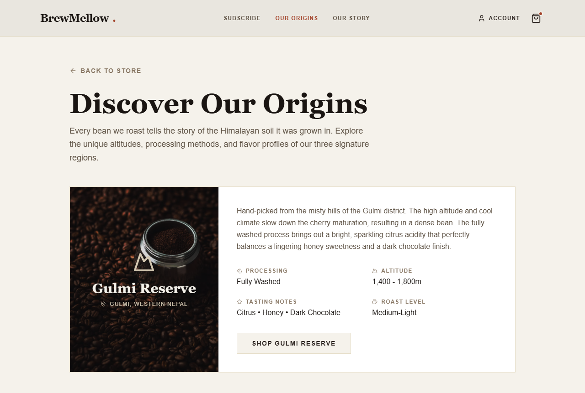
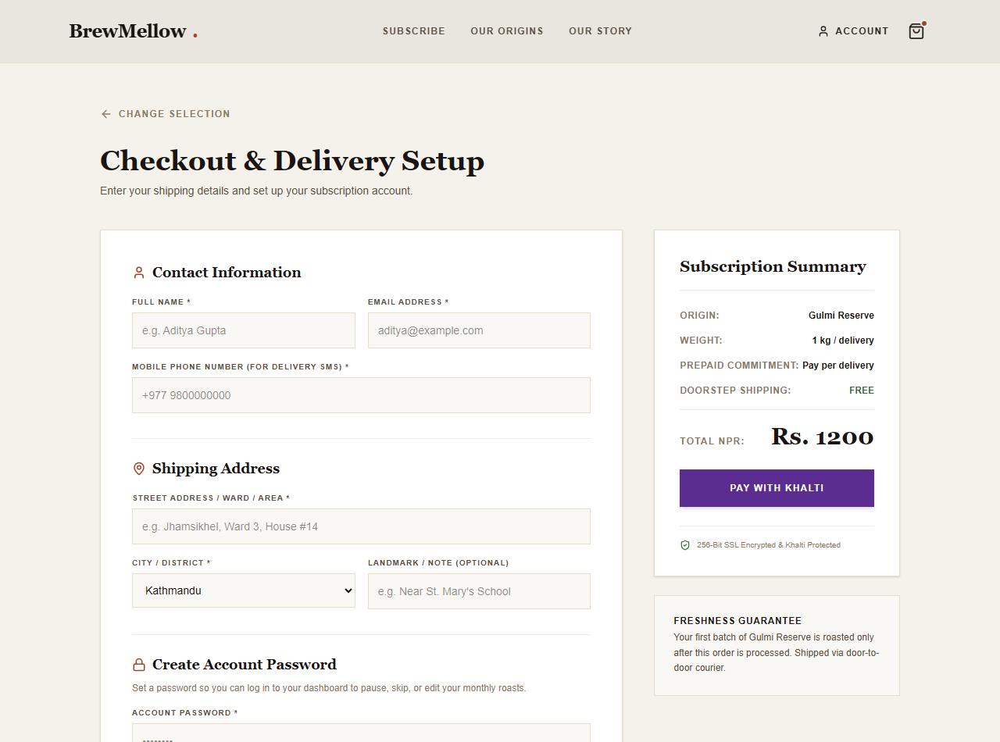
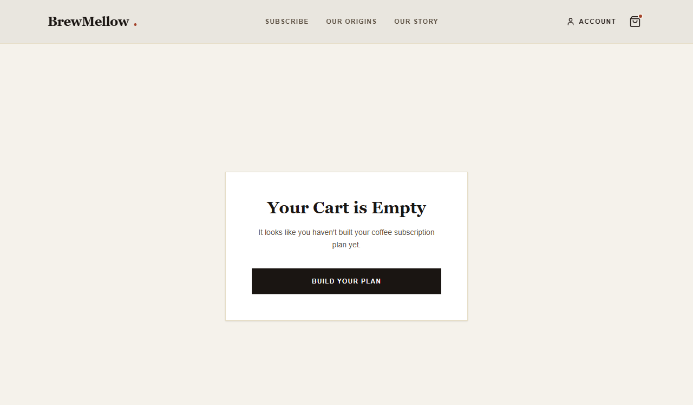
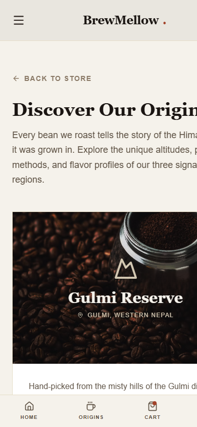

# Midterm Presentation Slide Deck — BrewMellow

**Course:** Capstone Design — Fall 2026  
**Presentation:** 3–5 Minutes (Midterm — 15% of Course Grade)  
**Team:** Team 2 — BrewMellow  
**Live Deployed Application:** [https://team-2-capstone-design-one.vercel.app](https://team-2-capstone-design-one.vercel.app)  
**Repository:** [https://github.com/CapstoneDesign-Fall2026-UlsanCollege/team_2_capstone_design](https://github.com/CapstoneDesign-Fall2026-UlsanCollege/team_2_capstone_design)

---

## Slide 1: Title & The Specialty Coffee Problem
**Presenter:** **Aanchal (`jaasly07`)**  
**Duration:** 0:00 – 0:45

### BrewMellow
*Direct-Trade Artisanal Himalayan Coffee Roastery & Subscription Platform*

- **Target User:** Specialty coffee enthusiasts and home-brewers in Nepal and diaspora looking for freshly roasted, traceable single-origin beans.
- **The Core Problem:**
  - Commercial retail coffee in Kathmandu consists of stale, dark-roasted commercial blends with zero harvest altitude or processing transparency.
  - Coffee drinkers cannot easily subscribe to micro-lot roasts tailored to their favorite brewing equipment (Pour-Over, Aeropress, French Press).
- **Our Solution:** An end-to-end e-commerce vertical slice allowing customers to discover regional Nepali origins (Gulmi, Ilam, Nuwakot), customize roasts, and schedule door-to-door deliveries.

---

## Slide 2: The Verified Slice & Live Walkthrough
**Presenter:** **Aditya (`notyouradhee`)**  
**Duration:** 0:45 – 1:45  
**Live Link:** [https://team-2-capstone-design-one.vercel.app](https://team-2-capstone-design-one.vercel.app)

### Core User Path Demonstrated Live:
1. **Homepage $\rightarrow$ `/origins`:** Browse 3 single-origin micro-lots with altitude and sensory profiles.
2. **Select Origin ("Gulmi Reserve"):** State persists seamlessly into `/checkout?origin=1&name=Gulmi%20Reserve&plan_id=PAYG&price=1200`.
3. **Checkout Validation & Submission:** Form validation, live price breakdown, and order submission to Django REST API.
4. **Order Confirmation:** Order persisted in Neon PostgreSQL with status `CONFIRMED`.

### Visual Evidence:

*Figure 1: Nepali Single-Origin Selection Page ([origins-selection.png](../week-06/evidence/origins-selection.png))*

---

## Slide 3: Scope Boundaries (Honest Engineering Proof)
**Presenter:** **Aditya (`notyouradhee`)**  
**Duration:** 1:45 – 2:15

| What the Current Slice PROVES | What the Current Slice DOES NOT PROVE |
|---|---|
| Full client routing and URL state preservation from `/origins` to `/checkout`. | **No Live Payment Deductions:** Payment is simulated via `is_fake_payment=True`. No live Khalti or bank funds are touched. |
| Production deployment live on Vercel with HTTPS and mobile PWA manifest. | **No Email Dispatch Yet:** Order records are saved to the database, but automated SMTP customer notifications remain in development. |
| Order persistence in Django ORM and hosted Neon PostgreSQL. | **No High-Concurrency Load:** Multi-instance database pooling has not been load-tested. |

### Visual Evidence:

*Figure 2: Complete Checkout & Delivery Setup with Simulated Payment ([checkout-flow.png](../week-06/evidence/checkout-flow.png))*

---

## Slide 4: Independent QA & Defensive Edge Cases
**Presenter:** **Kushan (`Kushan2191`)**  
**Duration:** 2:15 – 3:00

### Independent Clean-Clone Verification:
- **Tester:** `Kushan2191` (Non-author verification on separate hardware).
- **Method:** Followed documented setup steps from a clean clone without coaching.
- **Result:** Successfully browsed origins, selected Gulmi Reserve, and submitted order.
- **Code Review:** Reviewed and merged [PR #44](https://github.com/CapstoneDesign-Fall2026-UlsanCollege/team_2_capstone_design/pull/44) via [Commit 9d45f95](https://github.com/CapstoneDesign-Fall2026-UlsanCollege/team_2_capstone_design/commit/9d45f95).

### Defensive Edge-Case Handling: Direct `/checkout` Navigation
- **The Risk:** Direct visits or bookmarked links without origin parameters could crash with `undefined` null reference errors.
- **Our Handling:** Defensive routing catches the missing parameter and displays a friendly empty cart card with a "Build Your Plan" call-to-action.

### Visual Evidence:

*Figure 3: Defensive Empty Cart State on Direct Navigation ([checkout-empty-state.png](../week-06/evidence/checkout-empty-state.png))*

---

## Slide 5: Mobile Viewport & Accessibility Audit
**Presenter:** **Aanchal (`jaasly07`)**  
**Duration:** 3:00 – 3:25

### WCAG 2.1 AA Mobile Testing (390 x 960 px):
- Single-column stacked responsive grid on mobile screens ($< 768\text{px}$).
- All CTA buttons styled with `py-3 px-6` providing a minimum 52px touch-friendly thumb target.
- **Stretch Fix:** Resolved a fixed-bottom collision where the mobile navigation bar overlapped the checkout button by applying safe-area padding (`pb-28`) in [Commit 7b55d72](https://github.com/CapstoneDesign-Fall2026-UlsanCollege/team_2_capstone_design/commit/7b55d72).

### Visual Evidence:

*Figure 4: 390px Mobile Viewport Layout and Touch Targets ([origins-mobile.png](../week-06/evidence/origins-mobile.png))*

---

## Slide 6: Backend Resilience & Outage Recovery
**Presenter:** **Rohit (`Rohit-coder201`)**  
**Duration:** 3:25 – 3:45

### API Outage & Recovery Smoke Testing:
- Simulated a complete backend outage by stopping the Django service.
- Verified that the frontend gracefully handles connection failures, surfaces an alert, and recovers cleanly upon server restart.
- Documented repeatable curl commands in the project README for continuous verification.

```bash
# Repeatable Verification Command
curl -s -X POST http://localhost:8000/api/orders/ \
  -H "Content-Type: application/json" \
  -d '{"origin_id":1,"origin_name":"Gulmi Reserve","total_price_npr":1200,"customer_name":"Smoke Test"}'
```

---

## Slide 7: Sprint 1 Quality & Post-Midterm Roadmap
**Presenter:** **Rohit (`Rohit-coder201`)**  
**Duration:** 3:45 – 4:00

### Quality Status:
- [x] Vertical slice fully verified by independent teammate.
- [x] Production deployed at `https://team-2-capstone-design-one.vercel.app`.
- [x] Zero secrets in repository; safe mock data only.
- [x] Clear setup and run instructions in README.

### Next Steps for Sprint 2 (Post-Midterm):
1. **Live Khalti Sandbox SDK Integration:** Replace the simulated payment modal with real test mobile wallet credentials.
2. **Transactional Email Service:** Integrate automated customer confirmation and courier tracking emails via SMTP/SendGrid.
3. **Roastery Operations Portal:** Expand backoffice fulfillment status management for roasters.
