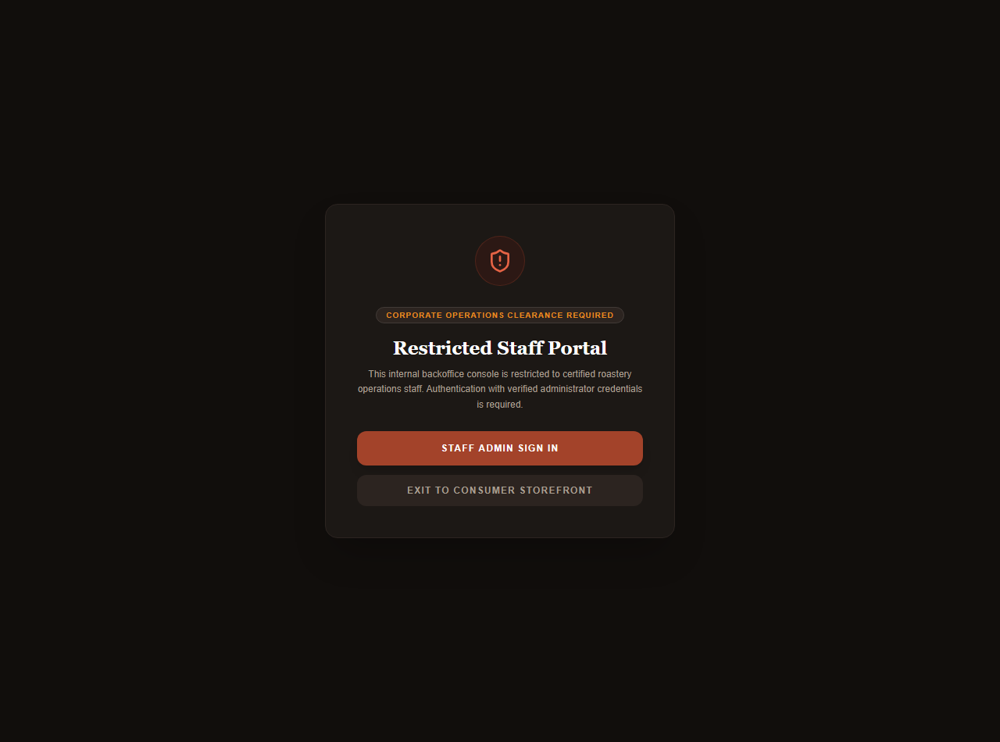

# Midterm Presentation Slide Deck — BrewMellow

**Course:** Capstone Design — Fall 2026  
**Presentation:** 5–7 Minutes (Midterm — 15% of Course Grade)  
**Team:** Team 2 — BrewMellow  
**Live Deployed Application:** [https://team-2-capstone-design-one.vercel.app](https://team-2-capstone-design-one.vercel.app)  
**Repository:** [https://github.com/CapstoneDesign-Fall2026-UlsanCollege/team_2_capstone_design](https://github.com/CapstoneDesign-Fall2026-UlsanCollege/team_2_capstone_design)

---

## Slide 1: The User & Problem (No Feature Pitching)
**Presenter:** **Aanchal (`jaasly07`)**  
**Duration:** 0:00 – 0:40

### Who is this for?
- **Target User:** Specialty coffee enthusiasts and home-brewers in Nepal and diaspora seeking single-origin Himalayan coffees.

### What is the real problem?
- **Zero Transparency:** Commercial grocery store coffee in Kathmandu consists of stale, dark-roasted commercial blends with zero altitude, farm, processing, or roast date information.
- **No Direct Subscriptions:** Drinkers cannot customize roast profiles for their specific brewing equipment (Pour-Over, Aeropress, French Press) or receive fresh doorstep deliveries.

---

## Slide 2: Scope of this Demo & Full-Stack Architecture
**Presenter:** **Aditya (`notyouradhee`)**  
**Duration:** 0:40 – 1:15

### Technical Architecture
- **Frontend:** Next.js 16 (React 19) + Tailwind CSS, deployed live on **Vercel** with HTTPS.
- **Backend:** Django REST Framework API with PostgreSQL ORM.
- **Database:** Hosted **Neon PostgreSQL** serverless cluster.

### Scope Boundary (Stated Upfront)
- **Verified Vertical Slice:** Origin browsing $\rightarrow$ checkout parameter synchronization $\rightarrow$ simulated order persistence $\rightarrow$ customer dashboard & admin console.
- **What is Simulated:** Payment is flagged internally as `is_fake_payment=True`. No live Khalti or bank money is deducted, but real order records are created and persisted in the database.

---

## Slide 3: Live Walkthrough — Regional Origins to Dynamic Checkout
**Presenter:** **Aditya (`notyouradhee`)**  
**Duration:** 1:15 – 2:00  
**Live Action:** Open [https://team-2-capstone-design-one.vercel.app/origins](https://team-2-capstone-design-one.vercel.app/origins)

### What the user sees:
1. **Three Himalayan Micro-Lots:**
   - *Gulmi Reserve* (1,600m — Fully Washed — Citrus & Dark Chocolate)
   - *Ilam Gold* (1,800m — Natural Sun-Dried — Alpine Berry & Caramel)
   - *Nuwakot Heritage* (1,400m — Honey Processed — Roasted Walnut & Molasses)
2. **State Synchronization:** Clicking **"Shop Gulmi Reserve"** carries origin ID, name, plan, and price directly into `/checkout?origin=1&name=Gulmi%20Reserve&plan_id=PAYG&price=1200`.

### Visual Evidence:

*Figure 1: Nepali Single-Origin Selection Page ([origins-selection.png](../week-06/evidence/origins-selection.png))*

---

## Slide 4: Checkout Submission & Simulated Payment Confirmation
**Presenter:** **Aditya (`notyouradhee`)**  
**Duration:** 2:00 – 2:45  
**Live Action:** Fill out customer form $\rightarrow$ Click 'Pay with Khalti'

### What happens under the hood:
1. **Client-Side Form Validation:** Validates full name, email format, Nepal phone prefix, and delivery street address.
2. **Server-Side API Call:** Dispatches `POST /api/orders/` to the Django REST backend.
3. **Database Persistence:** An order record is saved into Neon PostgreSQL with status `CONFIRMED`.
4. **Interactive Modal:** Surfaces a 2.0-second simulated payment modal confirming the order with zero fake claims.

### Visual Evidence:

*Figure 2: Complete Checkout & Delivery Setup with Simulated Payment ([checkout-flow.png](../week-06/evidence/checkout-flow.png))*

---

## Slide 5: Customer Roastery Portal & Operations Backoffice
**Presenter:** **Aditya (`notyouradhee`)**  
**Duration:** 2:45 – 3:30  
**Live Action:** Open `/dashboard` $\rightarrow$ Open `/admin`

### 1. Customer Roastery Portal (`/dashboard`)
- Active subscription box (Nuwakot Heritage, 2 kg prepay, pour-over grind).
- Next roast date scheduled for October 18, 2026.
- **Himalayan Roastery & Live Delivery Tracker:** Real-time 4-stage tracking (*Confirmed $\rightarrow$ Roasting $\rightarrow$ Dispatched $\rightarrow$ Delivered*).

### 2. Admin Operations Console (`/admin`)
- Operations KPIs: Gross Revenue (Rs. 22,150), 5 Active Subscribers, 1 Roastery Batch, 2 Shipments in-transit.
- Live Orders Queue: Interactive lifecycle status dropdowns to dispatch or deliver roastery lots.

### Visual Evidence:

*Figure 3: Customer Portal with Active Box & Live Tracker ([dashboard-orders.png](../week-06/evidence/dashboard-orders.png))*


*Figure 4: Roastery Operations Backoffice Console ([admin-backoffice.png](../week-06/evidence/admin-backoffice.png))*

---

## Slide 6: Independent QA & Defensive Empty-Cart Edge Case
**Presenter:** **Kushan (`Kushan2191`)**  
**Duration:** 3:30 – 4:15  
**Live Action:** Navigate directly to `https://team-2-capstone-design-one.vercel.app/checkout`

### 1. Non-Author Testing on Independent Hardware
- Re-tested the complete flow from a clean clone without author coaching.
- Verified all three coffee cards and reviewed/merged [PR #44](https://github.com/CapstoneDesign-Fall2026-UlsanCollege/team_2_capstone_design/pull/44) via [Commit 9d45f95](https://github.com/CapstoneDesign-Fall2026-UlsanCollege/team_2_capstone_design/commit/9d45f95).

### 2. Defensive Edge Case: Empty Cart Recovery
- **Problem:** If a customer directly bookmarks or visits `/checkout` without selecting an origin, unhandled code would throw an `undefined` null crash.
- **Our Handling:** Defensive routing detects missing parameters and displays a clean **"Your Cart is Empty"** fallback card with a direct **"Build Your Plan"** button back to `/origins`.

### Visual Evidence:

*Figure 5: Defensive Empty Cart State on Direct Navigation ([checkout-empty-state.png](../week-06/evidence/checkout-empty-state.png))*

---

## Slide 7: Mobile PWA & WCAG Accessibility Audit
**Presenter:** **Aanchal (`jaasly07`)**  
**Duration:** 4:15 – 5:00  
**Live Action:** Switch browser DevTools to 390px mobile viewport

### Mobile-First Testing (390 x 960 px):
- **Responsive Stacking:** Origin grid cleanly collapses to `grid-cols-1` with zero horizontal overflow.
- **Ergonomic Touch Targets:** All CTA buttons styled with `py-3 px-6` providing a minimum 52px thumb target.
- **Fixed Bottom Collision Bug Fix:** Resolved an overlap where the mobile navigation bar covered the checkout payment CTA by adding safe-area padding (`pb-28`) in [Commit 7b55d72](https://github.com/CapstoneDesign-Fall2026-UlsanCollege/team_2_capstone_design/commit/7b55d72).

### Visual Evidence:

*Figure 6: 390px Mobile Viewport Layout and Touch Targets ([origins-mobile.png](../week-06/evidence/origins-mobile.png))*

---

## Slide 8: Backend Outage Resilience Smoke Testing
**Presenter:** **Rohit (`Rohit-coder201`)**  
**Duration:** 5:00 – 5:45  
**Live Action:** Show terminal curl verification commands

### API Failure Recovery:
- Simulated an unannounced backend outage by shutting down the Django API service.
- Verified that the frontend gracefully intercepts network connection drops and alerts the user rather than freezing or crashing.
- Documented repeatable curl commands in the project README for fast health auditing.

```bash
# Repeatable Verification Command
curl -s -X POST http://localhost:8000/api/orders/ \
  -H "Content-Type: application/json" \
  -d '{"origin_id":1,"origin_name":"Gulmi Reserve","total_price_npr":1200,"customer_name":"Smoke Test"}'
```

---

## Slide 9: Honest Boundaries & Sprint 2 Roadmap
**Presenter:** **Rohit (`Rohit-coder201`)**  
**Duration:** 5:45 – 6:30

### What is Incomplete Today:
1. **Live Payment Integration:** Real Khalti mobile wallet sandbox credentials are not yet wired into the checkout button.
2. **Automated Email Dispatch:** Order receipts are stored in PostgreSQL, but customer confirmation emails via SMTP/SendGrid remain in progress.

### Sprint 2 Next Steps (Immediately Following Midterm):
- [ ] Connect Khalti Sandbox SDK for real test wallet payments.
- [ ] Implement automated customer confirmation emails upon order creation.
- [ ] Expand Roastery Backoffice order fulfillment workflows for roasters.
