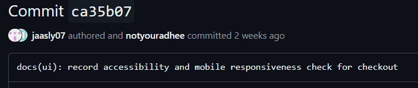
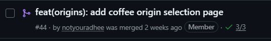
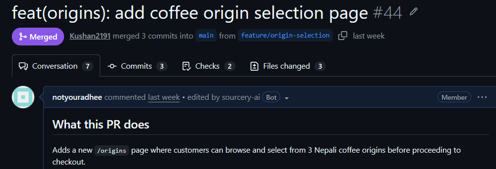
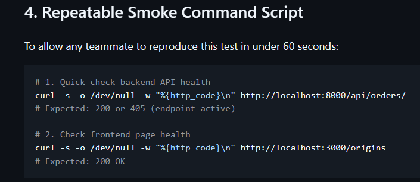

# Midterm Presentation Slide Deck — BrewMellow

**Course:** Capstone Design — Fall 2026  
**Presentation:** Midterm Presentation (15% of Course Grade)  
**Team:** Team 2 — BrewMellow  
**PowerPoint File:** [`BrewMellow_Midterm_Presentation.pptx`](BrewMellow_Midterm_Presentation.pptx)  
**Live Deployed Application:** [https://team-2-capstone-design-one.vercel.app](https://team-2-capstone-design-one.vercel.app)  
**Repository:** [https://github.com/CapstoneDesign-Fall2026-UlsanCollege/team_2_capstone_design](https://github.com/CapstoneDesign-Fall2026-UlsanCollege/team_2_capstone_design)

---

## Slide 1: Title & Overview
**Badge:** `CAPSTONE DESIGN MIDTERM · TEAM -2`

### BrewMellow.
*Nepali specialty coffee, roasted to order and delivered fresh*

- **Team Members:**
  - **Aanchal Chand Thakuri** (`@jaasly07`)
  - **Aditya Kumar Gupta** (`@notyouradhee`)
  - **Kushan Sunuwar** (`@Kushan2191`)
  - **Rohit Chhantiyal** (`@Rohit-coder201`)
- **GitHub Link:** [https://github.com/CapstoneDesign-Fall2026-UlsanCollege/team_2_capstone_design](https://github.com/CapstoneDesign-Fall2026-UlsanCollege/team_2_capstone_design)
- **Live Demo:** [https://team-2-capstone-design-one.vercel.app](https://team-2-capstone-design-one.vercel.app)

---

## Slide 2 (1/8): The User & The Specialty Coffee Problem
**Presenter:** Aanchal Chand Thakuri · `@jaasly07` | **Slide:** 1/8

### THE TARGET USER
- Specialty coffee enthusiasts and home-brewers in Nepal and the diaspora.
- They seek single-origin Himalayan beans with distinct elevations and processing methods (Washed, Natural, Honey) for manual brewing: V60, Aeropress, French Press.

### THE REAL PROBLEM
- **Zero transparency in retail:** Kathmandu supermarket coffee is stale, dark-roasted commercial blend with no harvest altitude, processing method or roast date.
- **Inaccessible micro-lots:** Premium beans from Gulmi, Ilam and Nuwakot are mostly exported. Locals have no direct platform for fresh roast-to-order subscriptions.

---

## Slide 3 (2/8): Scope of this Demo & Full-Stack Architecture
**Presenter:** Aditya Kumar Gupta · `@notyouradhee` | **Slide:** 2/8

### TECHNICAL ARCHITECTURE
- **Frontend:** Next.js 16 (React 19) + Tailwind CSS, live on Vercel over HTTPS.
- **Backend API:** Django 5.1 REST Framework for orders and data models.
- **Database:** Serverless PostgreSQL cluster on Neon.

### TRANSPARENT SCOPE BOUNDARY
- **What is verified:** End-to-end flow from browsing origins to checkout state sync, database records, customer dashboard and roastery backoffice.
- **What is simulated:** Payment is flagged `is_fake_payment=True`. No real cards or Khalti balances are charged; real orders are still saved and tracked.

---

## Slide 4 (3/8): Live Walkthrough: The Verified Vertical Slice
**Presenter:** Aditya Kumar Gupta · `@notyouradhee` | **Slide:** 3/8  
**Live URL:** [https://team-2-capstone-design-one.vercel.app/origins](https://team-2-capstone-design-one.vercel.app/origins)

- **1 · /ORIGINS (Regional origins):** 3 micro-lots: Gulmi Reserve (1,600m), Ilam Gold (1,800m), Nuwakot Heritage (1,400m).
- **2 · /CHECKOUT (State synchronization):** Gulmi Reserve passes parameters in the URL query string; total Rs. 1,200 recalculates with no state loss.
- **3 · POST /API/ORDERS/ (Payment & order record):** Writes an order row to PostgreSQL and opens the 2.0s simulated confirmation modal.
- **4 · /DASHBOARD · /ADMIN (Post-purchase hubs):** 4-stage tracking (Confirmed → Roasting → Dispatched → Delivered); admin shows Rs. 22,150 revenue and roasting queues.

---

## Slide 5 (4/8): Individual Contribution: Aanchal Chand Thakuri (@jaasly07)
**Role:** Frontend & Accessibility Auditor | **Presenter:** Aanchal Chand Thakuri | **Slide:** 4/8

### CONCRETE CONTRIBUTIONS
- Formulated the target user persona and the specialty coffee retail transparency problem.
- Audited the vertical slice at a 390px mobile viewport against WCAG 2.1 AA.
- Verified all CTA buttons give a 52px thumb target (`py-3 px-6`).

### GITHUB EVIDENCE & PROOF
- **Commit `ca35b07`:** `docs(ui): record accessibility and mobile responsiveness check for checkout`
- **Test record:** [`docs/week-06/accessibility-and-mobile-check.md`](../week-06/accessibility-and-mobile-check.md)
- **Receipt:** [`docs/week-07/receipts/receipt-aanchal.md`](receipts/receipt-aanchal.md)

---

## Slide 6 (5/8): Individual Contribution: Aditya Kumar Gupta (@notyouradhee)
**Role:** Project Lead & Full-Stack | **Presenter:** Aditya Kumar Gupta | **Slide:** 5/8

### CONCRETE CONTRIBUTIONS
- Architected the full-stack vertical slice: Next.js 16, Django REST Framework, Neon PostgreSQL.
- Built `/origins` to `/checkout` state sync via URL parameters, preventing loss on reload.
- Deployed the production app on Vercel over HTTPS.
- Built the customer dashboard, admin console and the simulated payment boundary (`is_fake_payment=True`).

### GITHUB EVIDENCE & PROOF
- **Issue:** [#43 “Feature: Coffee Origin Selection Page”](https://github.com/CapstoneDesign-Fall2026-UlsanCollege/team_2_capstone_design/issues/43)
- **Pull request:** [#44 “feat: origin selection flow with query-param checkout integration”](https://github.com/CapstoneDesign-Fall2026-UlsanCollege/team_2_capstone_design/pull/44)
- **Commit:** `30081cc` *“connect origin selection to checkout state”*
- **Receipt:** [`docs/week-07/receipts/receipt-aditya.md`](receipts/receipt-aditya.md)

---

## Slide 7 (6/8): Individual Contribution: Kushan Sunuwar (@Kushan2191)
**Role:** QA Lead & Code Reviewer | **Presenter:** Kushan Sunuwar | **Slide:** 6/8

### CONCRETE CONTRIBUTIONS
- Ran an independent clean-clone test on separate hardware, with no author coaching.
- Reviewed PR #44, verified parameter behavior and merged it (merge commit `9d45f95`).
- Tested the empty-cart edge case: opening `/checkout` with no parameters shows a “Your Cart is Empty” card with a “Build Your Plan” button instead of crashing.

### GITHUB EVIDENCE & PROOF
- **Merge commit:** `9d45f95` *“Merge pull request #44 from CapstoneDesign-Fall2026-UlsanCollege/feature/origin-selection”*
- **Test note:** [`docs/week-06/tested-by-note.md`](../week-06/tested-by-note.md)
- **Edge case commit:** `f69700e` *“add defensive empty cart fallback”*
- **Receipt:** [`docs/week-07/receipts/receipt-kushan.md`](receipts/receipt-kushan.md)

---

## Slide 8 (7/8): Individual Contribution: Rohit Chhantiyal (@Rohit-coder201)
**Role:** DevOps & Resilience Lead | **Presenter:** Rohit Chhantiyal | **Slide:** 7/8

### CONCRETE CONTRIBUTIONS
- Ran backend outage testing: stopped the Django server and verified the frontend handles the dropped connection with an explicit alert.
- Wrote repeatable curl smoke-test commands in the README for continuous health checks.
- Completed Sprint 1 Quality Quick Checks confirming zero secrets and safe demo data.

### GITHUB EVIDENCE & PROOF
- **Outage test record:** [`docs/week-06/api-smoke-test-record.md`](../week-06/api-smoke-test-record.md)
- **README section:** [`README.md#smoke-testing`](../../README.md#4-repeatable-smoke-command-script)
- **Quality checks:** [`docs/week-07/sprint-1-quality-quick-checks.md`](sprint-1-quality-quick-checks.md)
- **Receipt:** [`docs/week-07/receipts/receipt-rohit.md`](receipts/receipt-rohit.md)

---

## Slide 9 (8/8): Next Steps & Sprint 2 Post-Midterm Roadmap
**Presenter:** Aditya Kumar Gupta · `@notyouradhee` | **Slide:** 8/8

### WHAT REMAINS INCOMPLETE TODAY
- **Simulated payment gateway:** Checkout uses the mock flag `is_fake_payment=True`; real Khalti wallet sandbox deduction is pending.
- **Automated transactional emails:** Orders are saved to PostgreSQL; automated dispatch emails via SMTP are in progress.

### SPRINT 2 ACTION PLAN
1. **Khalti Sandbox SDK:** replace the simulated modal with real test wallet credentials (NPR).
2. **Transactional email:** automate confirmation and courier tracking emails on order placement.
3. **Roastery operations portal:** expand backoffice fulfillment status workflows.

*“Thank you, Professor and classmates. We welcome any questions!”*
